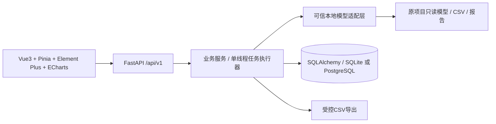
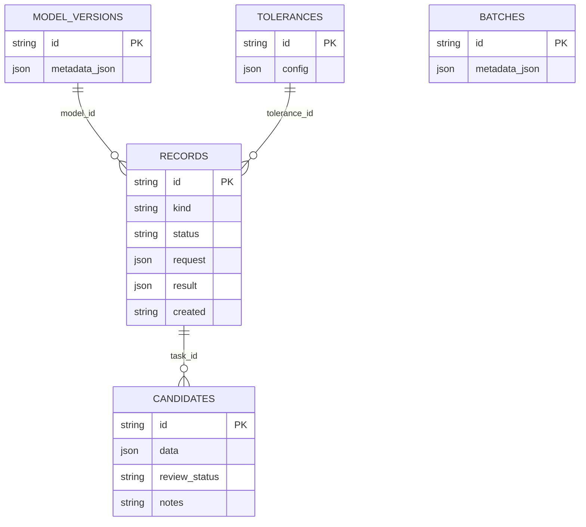

# 架构与数据库

采用紧凑模块而非大量空目录：core配置、ml模型适配、schemas请求校验、services业务与任务、db ORM、main接口。当前轻量原型的查询直接用SQLAlchemy会话，不增加无行为的仓储包装。记录不可静默重算；容差ID包含配置摘要。候选记录包含完整结果和复核状态。CSV、二进制与全部仿真表格在文件系统，数据库仅存元信息与业务记录。

任务单进程、单工作线程，无消息队列。重启后 queued/running 标记 interrupted，用户重新提交新任务。任务ID保存在浏览器，可刷新恢复，也可历史页查看。不能启用Uvicorn多worker。任务候选上限20000，原算法绝对上限250000；入口预估先拒绝过密网格。

模型自定义类通过 importlib 按可信源目录登记 welding、validate、enhanced、decision 模块，模型按版本缓存。业务路由不修改sys.path。环境与模型依赖需匹配。仅固定版本可信文件可加载。

数据库用Alembic迁移初始化，JSON字段兼容PostgreSQL；不使用SQLite专用业务语句。初版迁移从ORM元数据建表，后续变更应添加独立版本迁移，勿修改初版模型后复用初版迁移。
