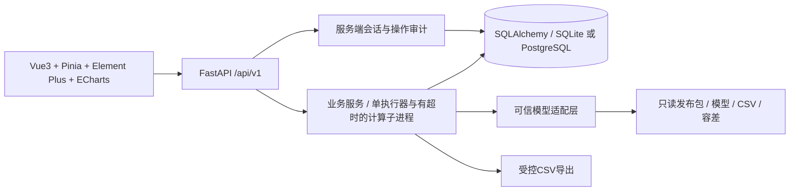
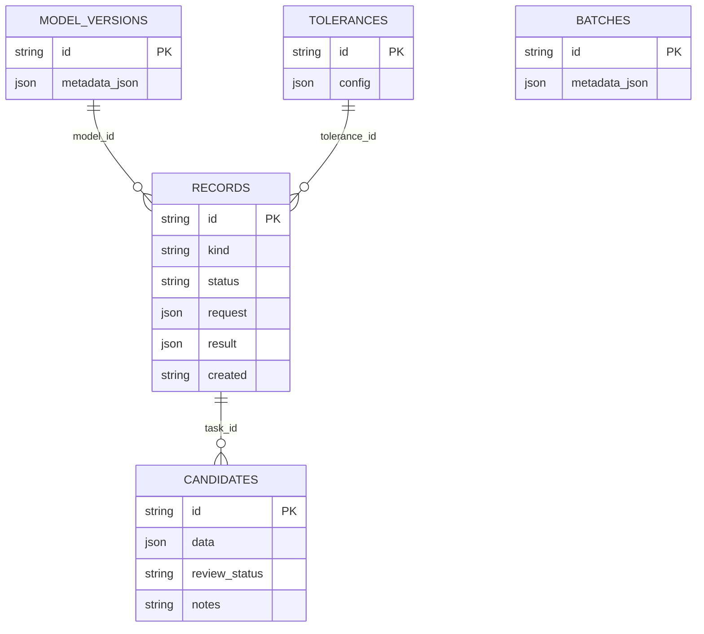

# 架构与数据库

采用紧凑模块而非大量空目录：core配置、ml模型适配、schemas请求校验、services业务与任务、db ORM、main接口。业务查询和会话状态直接使用 SQLAlchemy。记录不可静默重算；容差ID包含配置摘要。候选记录包含完整结果和复核状态。CSV、二进制与全部仿真表格在文件系统，数据库仅存元信息与业务记录。

生产部署使用单个 Uvicorn worker。推荐串行执行，队列上限覆盖运行中和等待的任务。单次计算使用有超时限制的子进程。重启把 queued/running 标记为 interrupted，显式重试生成带原任务 ID 的新记录。任务候选上限 20,000，入口预估先拒绝过密网格。

模型自定义类通过 importlib 按可信源目录登记 welding、validate、enhanced、decision 模块，模型按版本缓存。业务路由不修改sys.path。环境与模型依赖需匹配。仅固定版本可信文件可加载。

数据库使用显式 Alembic 迁移。001 冻结原业务表，002 增加管理员、会话与审计。开发默认 SQLite，生产使用 PostgreSQL 和独立的应用及迁移账号。既有历史可按部署文档导入。
